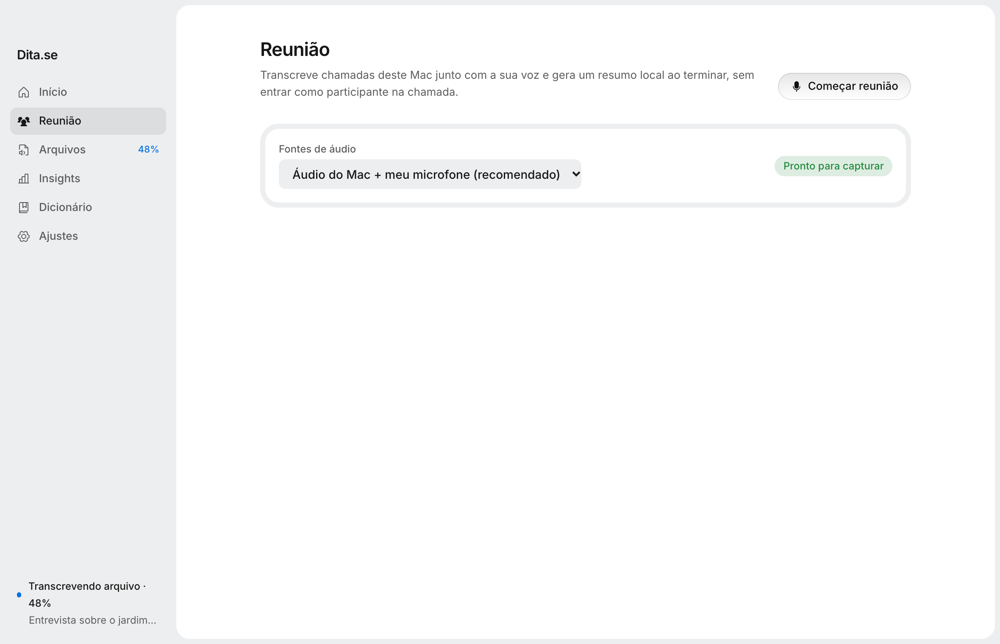

# Dita.se

Ditado por voz, transcrição de reuniões e transcrição de arquivos de áudio e vídeo com separação de falantes para Mac e Windows. Tudo roda localmente no seu computador, sem conta, sem assinatura e sem enviar áudio ou texto para servidores externos.


## O que é

O **Dita.se** transforma fala em texto direto no campo onde você está digitando e também transcreve chamadas e gravações longas:

- **Ditado rápido em qualquer aplicativo:** segure a tecla do atalho (`Opção direita ⌥` no Mac e `Ctrl direito` no Windows, por padrão), fale e solte. O texto entra no cursor já pontuado e sem hesitações vazias, preservando as palavras que você disse. Também há modo mãos livres pelo botão flutuante na tela.
- **Reuniões com falantes e resumo local:** captura o áudio do computador junto com o seu microfone durante chamadas (Meet, Zoom, Teams ou qualquer app), mostra a transcrição quase ao vivo, identifica quem falou ao encerrar e gera um resumo curto no modelo local.
- **Arquivos de áudio e vídeo:** arraste gravações (`mp3`, `m4a`, `wav`, `aac`, `flac`, `ogg`, `mp4`, `mov`, `m4v`, `webm`) para separar as vozes por trecho, renomear participantes e exportar em texto (`.txt`), Markdown (`.md`) ou legendas (`.srt` e `.vtt`).
- **Dicionário pessoal e estatísticas:** cadastre nomes próprios, siglas e termos técnicos para que saiam sempre com a grafia certa, inclusive por semelhança fonética.
- **Fidelidade ao que foi dito:** a limpeza opcional por modelo local só pontua, organiza parágrafos e remove muletas ou autocorreções; uma camada determinística impede que o modelo invente frases ou troque suas palavras por sinônimos.




## Requisitos

### Mac

- Mac com chip Apple (M1 ou superior)
- macOS 15 ou superior

### Windows

- Windows 10 (versão 1903 ou mais recente) ou Windows 11
- Computador de 64 bits (x64)

#### Instalar no Windows

1. Abra **Releases** na página deste repositório e baixe `Dita.se-windows-x64-setup.exe` e `SHA256SUMS.txt` da última versão.
2. Abra o PowerShell na pasta dos downloads e rode:

   ```powershell
   Get-FileHash -Algorithm SHA256 .\Dita.se-windows-x64-setup.exe
   ```

   Compare o resultado com o hash do instalador em `SHA256SUMS.txt`. Abra o instalador se os dois valores coincidirem.
3. O instalador configura o app para a sua conta, sem senha de administrador. Como ele ainda é distribuído sem assinatura Authenticode, o SmartScreen pode mostrar um aviso. Após conferir o hash, escolha **Mais informações** > **Executar assim mesmo**.

Para ditar, segure o **Ctrl direito**, fale e solte. Você pode trocar a tecla em **Ajustes**. No teclado brasileiro, o Alt direito funciona como AltGr.

Na primeira abertura, o app baixa cerca de 700 MB em modelos de fala e de separação de falantes. A IA de limpeza é opcional e pode ser baixada pela aba **Início**. O app verifica atualizações automaticamente ao abrir e pede sua confirmação antes de instalar.

## Instalar no Mac

### Opção 1: instalar por uma linha no Terminal (recomendado)

Abra o aplicativo **Terminal** e cole:

```bash
curl -fsSL -H 'Accept: application/vnd.github.raw+json' 'https://api.github.com/repositories/1464733163/contents/scripts/install.sh?ref=main' | bash
```

O script baixa o `.dmg` da última versão publicada no GitHub Releases, confere a integridade pelo hash SHA-256, copia o `Dita.se.app` para `/Applications` (ou `~/Applications` se a sua conta não for administradora) e remove o atributo de quarentena do download para que o app abra direto pelo ícone no Spotlight ou no Launchpad.

### Opção 2: baixar o DMG manualmente

1. Baixe o arquivo `Dita.se-mac-arm64.dmg` na página de **Releases** deste repositório.
2. Abra o `.dmg` e arraste o **Dita.se** para a pasta **Aplicativos**.
3. **Na primeira abertura:** como o aplicativo é distribuído com assinatura local gratuita (sem certificado pago da Apple), o macOS pode exibir um aviso dizendo que a Apple não pôde verificar o app. Para autorizar:
   - Tente abrir o **Dita.se** uma vez e feche o aviso.
   - Abra **Ajustes do Sistema** > **Privacidade e Segurança**.
   - Role até a seção **Segurança** e clique em **Abrir Mesmo Assim** ao lado da mensagem sobre o Dita.se.
   - Confirme com a senha ou Touch ID do Mac. Nas próximas vezes ele abrirá normalmente.

## Permissões no Mac

Na primeira vez que você usar cada função, o macOS pedirá as permissões correspondentes:

- **Microfone:** para ouvir a sua voz nos ditados e nas reuniões.
- **Acessibilidade:** para detectar o atalho global de teclado e colar o texto no campo em foco.
- **Gravação de Áudio do Sistema / Tela:** solicitada apenas quando você inicia uma reunião na aba **Reunião**, para ouvir os outros participantes da chamada. Nenhuma imagem da sua tela é gravada.

## Privacidade

- O reconhecimento de fala, a separação de vozes, a limpeza e os resumos rodam no computador. Seu áudio, suas transcrições e seu dicionário ficam no dispositivo.
- O app usa a internet para baixar os modelos. No Windows, também consulta e baixa atualizações.
- Os dados ficam em `~/Library/Application Support/Ditado` no Mac e em `%LOCALAPPDATA%\Dita.se` no Windows.

## Desinstalar

### Mac

1. Feche o Dita.se e mova `/Applications/Dita.se.app` (ou `~/Applications/Dita.se.app`) para a Lixeira.
2. Se quiser apagar também o histórico, o dicionário, as reuniões e o modelo de limpeza, remova a pasta `~/Library/Application Support/Ditado`.
3. O modelo de reconhecimento de fala e o de separação de vozes ficam num cache da biblioteca FluidAudio, em `~/Library/Application Support/FluidAudio/Models`. Essa pasta pode ser usada por outros apps que usam a mesma biblioteca. Se nenhum outro app precisar dela, pode removê-la também.

### Windows

Em **Configurações** > **Aplicativos**, encontre **Dita.se** e escolha **Desinstalar**. Se quiser remover também o histórico, as preferências e os modelos baixados, remova `%LOCALAPPDATA%\Dita.se`.

<details>
<summary><strong>Seção avançada: compilação a partir do código-fonte, arquitetura e testes</strong></summary>

### Arquitetura do projeto

#### Versão Mac

- **`Nucleo/` (pacote Swift independente de interface):** segmentador de áudio por pausas, sessão de ditado, regras determinísticas de fala (`RegrasFala`), dicionário fonético (`AplicadorDicionario`), travas contra alucinação ou reescrita do modelo (`Guarda` e `Fidelidade`), persistência transacional de ditados, arquivos e reuniões em SQLite (`Banco`, `ArmazemLancamento`, `Costura`) e cálculo de estatísticas.
- **`Ditado/` (aplicativo macOS em AppKit + SwiftUI):** captura de atalho por event tap, gravação de microfone e de áudio do sistema (ScreenCaptureKit), decodificação de mídia (AVFoundation), integração com FluidAudio (Parakeet Ultra e Sortformer), gerenciamento sob demanda do processo `llama-server`, pílula flutuante e ponte WebKit (`ditado://`).
- **`ui/` (React 19 + TypeScript + Vite + Tailwind CSS 4 + Tuff UI):** interface da janela principal com as abas Início, Reunião, Arquivos, Insights, Dicionário e Ajustes.
- **`project.yml`:** especificação do XcodeGen que gera `Ditado.xcodeproj`.

#### Versão Windows

- **`windows/src-tauri/`** usa Tauri 2 e WebView2 para exibir a mesma interface de `ui/`. Implementa o gancho de teclado, a colagem sem registrar o texto temporário no histórico do Win+V, a captura WASAPI de microfone e áudio do sistema, a pílula e a bandeja.
- **`nucleo-rs/`** porta o núcleo Swift para Rust. Ele reúne as regras de texto, o dicionário, o histórico, as reuniões e a recuperação de gravações interrompidas. Os dois núcleos executam os casos de teste compartilhados em `contrato/casos/`.
- **`motores/`** executa o Parakeet via sherpa-onnx e separa os falantes. A limpeza e o resumo usam llama.cpp na CPU, com servidor em `127.0.0.1`, TLS e chave gerada a cada execução.
- **GitHub Actions** compila e testa o aplicativo e gera o instalador NSIS. O fluxo confere o SHA-256 das bibliotecas de terceiros baixadas e testa a regressão da taxa de erro de palavras (WER) do Parakeet.
- **Atualizador** verifica a assinatura minisign do instalador indicado em `latest.json`, na release. A chave privada fica fora do repositório.

### Compilar e testar no Windows

Em um Windows x64 com Rust (MSVC), ferramentas de build do Visual Studio, WebView2 e Node.js com npm, rode no Git Bash, a partir da raiz do repositório:

```bash
powershell.exe -NoProfile -File scripts/windows/preparar-vendor.ps1
sherpa_lib="$(find target/ditase-extract-sherpa -name sherpa-onnx-c-api.lib -print -quit)"
sherpa_dir="$(dirname "$sherpa_lib")"
export SHERPA_ONNX_LIB_DIR="$(cygpath -w "$sherpa_dir")"
export PATH="$(cd "$sherpa_dir" && pwd):$PATH"

(cd ui && npm ci && npm run build)
cargo test --locked --workspace --all-targets --release --features ditase/custom-protocol

npm ci --prefix scripts/windows/tauri-cli --ignore-scripts --no-audit --no-fund
cd windows
node ../scripts/windows/tauri-cli/node_modules/@tauri-apps/cli/tauri.js build --bundles nsis --ci \
  --config src-tauri/tauri.distribuicao.conf.json \
  --config '{"bundle":{"createUpdaterArtifacts":false,"windows":{"nsis":{"installMode":"currentUser"}}}}' -- --locked
```

O instalador local sai em `target/release/bundle/nsis/`, na raiz do projeto. Veja também [os detalhes da versão Windows](windows/README.md) e [o fluxo de CI](.github/workflows/ci.yml).

### Pré-requisitos para compilar no Mac

- Xcode 16+ e ferramentas de linha de comando do Xcode
- [XcodeGen](https://github.com/yonaskolb/XcodeGen) (`brew install xcodegen`)
- Node.js 20+ e npm
- `llama.cpp` (`brew install llama.cpp`) para limpeza com IA e resumo local, com modelos `.gguf` colocados em `~/Library/Application Support/Ditado/Models` (ex.: `Qwen3.5-2B-Q4_K_M.gguf`)

### Compilar e rodar no Mac

```bash
# 1. Instalar dependências e gerar o build da interface web
cd ui
npm ci
npm run build
cd ..

# 2. Compilar o aplicativo macOS (Debug ou Release)
scripts/compilar.sh Release

# 3. (Opcional) Assinar com identidade local estável e instalar em /Applications
scripts/instalar.sh
```

Para preservar um identificador de bundle personalizado na sua máquina sem alterar o `project.yml` versionado, crie um arquivo `local.local.xcconfig` na raiz (ignorado pelo Git) com `PRODUCT_BUNDLE_IDENTIFIER = seu.identificador`: o `scripts/instalar.sh` o aplica automaticamente.

### Rodar os testes no Mac

```bash
swift test --package-path Nucleo
```

### Linha de comando (sem abrir a interface)

O binário compilado aceita modos de linha de comando para testes automatizados e avaliação:

```bash
# Transcrever um arquivo WAV curto de ditado
Dita.se.app/Contents/MacOS/Dita.se --transcrever audio.wav --sem-ia

# Transcrever arquivo de áudio ou vídeo com separação de falantes (devolve JSON)
Dita.se.app/Contents/MacOS/Dita.se --transcrever-arquivo gravacao.mp4 --falantes --sem-ia

# Simular reunião a partir de arquivos de áudio do sistema e do microfone
Dita.se.app/Contents/MacOS/Dita.se --reuniao-simulada sistema.mp4 microfone.wav --sem-resumo
```

Mais detalhes técnicos sobre o contrato da ponte WebKit, o modelo de persistência de reuniões e as especificações de movimento estão na pasta [`docs/`](docs/).

</details>

## Licença

Distribuído sob a licença [MIT](LICENSE).
